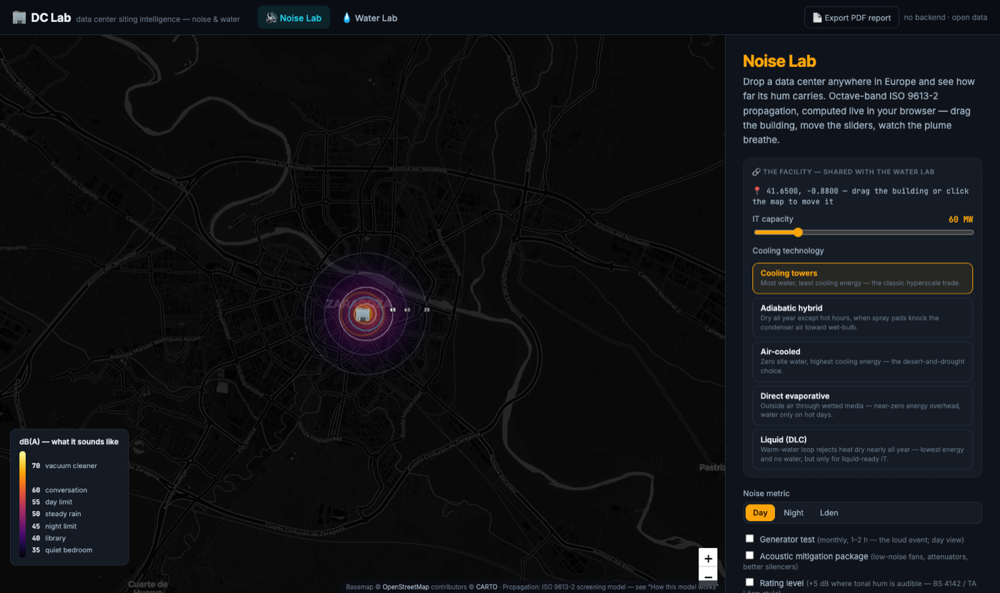
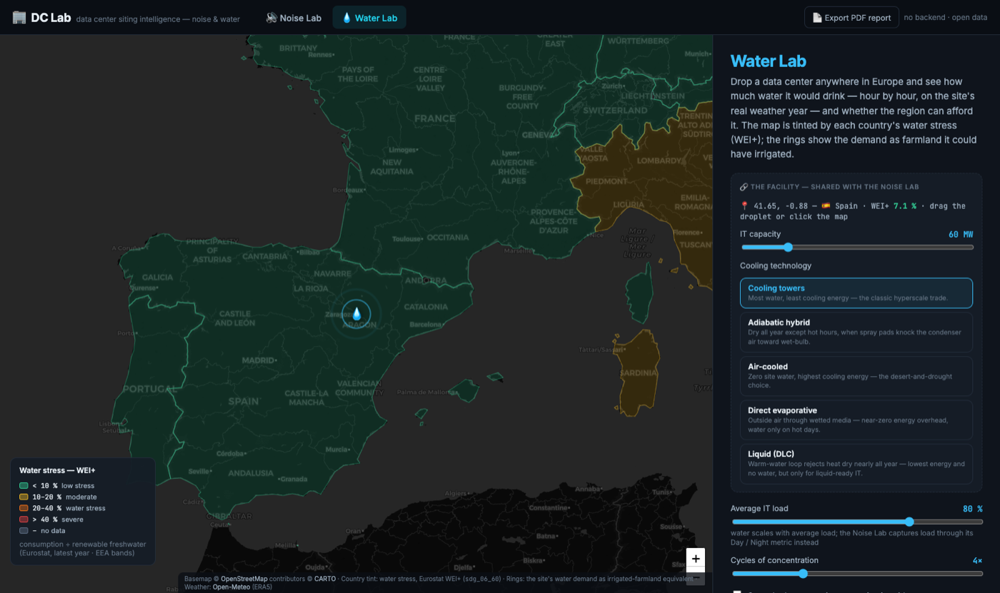

# 🏢 DC Lab — Data-Center Siting Intelligence

**How loud will it be? How much water will it drink? Can the region afford it?**

DC Lab answers the questions every data-center siting debate turns on — with
interactive, physics-based models you can interrogate, not a brochure. Drop a
facility anywhere in Europe, drag it around, switch cooling technologies, and
watch the noise plume and the water bill respond in real time. Built for policy
makers, planners, journalists and the communities next to proposed sites.
**Every assumption is disclosed in-app, every constant carries a citation.**

| | |
|---|---|
|  |  |

## The two labs

| Lab | Question | Model |
|---|---|---|
| 🔊 **Noise Lab** | How far does the hum carry — and what do scale, cooling choice, walls and mitigation actually buy? | ISO 9613-2 octave-band outdoor propagation: ISO 9613-1 atmospheric absorption, ground effect, barrier diffraction, Lden / rating-level / long-term-meteorology layers, ~15,000 receptors, computed live in the browser |
| 💧 **Water Lab** | How much water would it need, when — and who feels it? | Hourly cooling thermodynamics over a real weather year: wet-bulb (Stull 2011), latent-heat-anchored evaporation, economizer control sequences, cycles-of-concentration blowdown — across five cooling technologies, plus the upstream water embedded in the site's electricity |

## What makes it useful

- **One facility, two lenses.** Site, IT capacity and cooling technology are a
  single shared definition — the technology you price for water is the same one
  that makes the noise. Move the building in one lab and it moves in the other.
- **Impact at the right scale.** Water consumption is shown against the national
  scarcity index (WEI+, where a single campus is honestly near-invisible) *and*
  against the host community's water utility (where the same campus can be a
  double-digit share of annual supply). Both numbers, side by side.
- **Perspective people can feel.** Olympic pools, person-equivalents, road
  tankers on the peak day — and rings on the map showing the annual demand as
  the irrigated farmland it could have watered instead.
- **The trade-offs are the point.** "Water-free" dry cooling isn't water-free —
  it moves demand upstream through the grid. The technology-comparison chart
  prices all five options with the selected country's actual generation mix.
- **One-click PDF report.** Both labs' current results, the site map, all
  charts, parameters, limits and the citation list — via the browser's print
  dialog, nothing uploaded anywhere.
- **Shareable scenarios.** All state lives in the URL — send a link and the
  recipient sees exactly your scenario.

## Running it

The app is fully static — no backend, no build step, no keys, no cookies, no
analytics. All physics runs in your browser; open data is fetched directly from
its official sources at view time.

```bash
git clone <this repo> && cd dclab
python3 -m http.server 8000        # any static file server works
```

Open <http://localhost:8000>. (A server is only needed because ES modules don't
load from `file://`.)

## The science, checked

The physics engines are pure, dependency-free modules with an executable
validation suite — ISO 9613-1 reference magnitudes, Stull wet-bulb reference
values, latent-heat and cycles-of-concentration identities, closed-form
hand-checks, and behavioral invariants (barriers never amplify; hotter climates
are thirstier):

```bash
npm test    # 28 checks, Node ≥ 20
```

Model **outputs** are cross-checked against published facility data — planning
figures for Meta's Talavera de la Reina campus, hyperscaler fleet WUE reports
(Google, Microsoft, Meta), the Uptime Institute PUE survey, and the Macknick
et al. water-factor medians. The full audit trail — every constant, its source,
and the model-vs-published comparison table — is in
**[REFERENCES.md](REFERENCES.md)**, also linked from each lab's
"How this model works" panel.

## Honest limits

These are **screening models**, and they say so prominently: they exist to make
siting, technology and disclosure debates concrete. A real permit needs a
certified noise assessment with measured source data and 3-D geometry, and a
water balance from the river-basin authority — national annual WEI+ understates
basin-level, summer-peak stress by design. The in-app assumptions panels list
everything each model deliberately ignores.

## Data sources & attribution

| Source | Used for | Terms |
|---|---|---|
| [Open-Meteo](https://open-meteo.com/) | ERA5 hourly weather year per site | CC-BY 4.0, free for non-commercial use |
| [Eurostat](https://ec.europa.eu/eurostat) | WEI+ water stress (`sdg_06_60`), renewable freshwater (`env_wat_res`), electricity by fuel (`nrg_bal_peh`) | Eurostat open reuse policy |
| [CARTO](https://carto.com/attributions) / [OpenStreetMap](https://www.openstreetmap.org/copyright) | Basemap tiles | Attribution required (shown in-app and on exports) |
| [GISCO](https://gisco-services.ec.europa.eu/) © EuroGeographics | Country polygons (bundled, `data/europe.geojson`) | Attribution required |

## Project layout

```
index.html          both labs, one page, hash-routed
css/style.css
js/
├── noise-model.js  ISO 9613-2 acoustics engine (pure)
├── water-model.js  cooling-water thermodynamics engine (pure)
├── noise.js        Noise Lab view · water.js  Water Lab view
├── facility.js     shared facility store (site, MW, cooling tech)
├── data.js         client-side data layer (Open-Meteo, Eurostat, bundled geo)
├── report.js       PDF report builder
└── util.js         formatting + chart theme
data/europe.geojson bundled polygons (tools/build_geo.py regenerates)
tests/              physics validation suites
```
